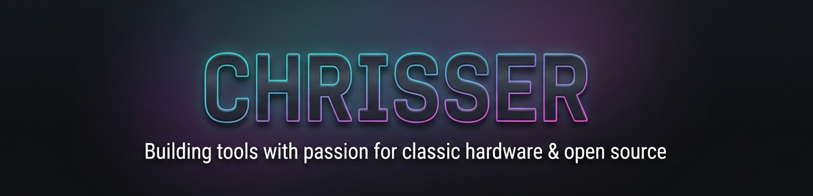

### 🕹️ Retro Enthusiast & Self-Hosted Tool Developer

*Building open-source custom tools, containerized services, and utilities for classic hardware❤️*

---

**Core:** Vue.js, TypeScript, Magnolia CMS, Astro, SCSS/Tailwind, Docker, Python and more
 
  

 👇
  

<small><i>Deploy a critical caffeine update to keep the open-source projects running smooth! ☕️✨</i></small>

